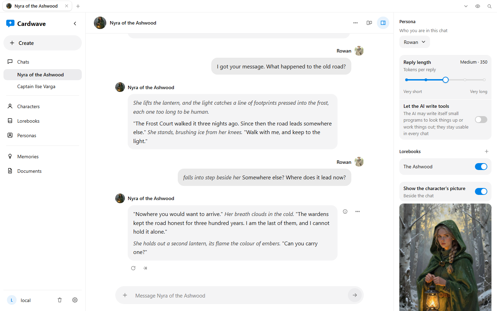
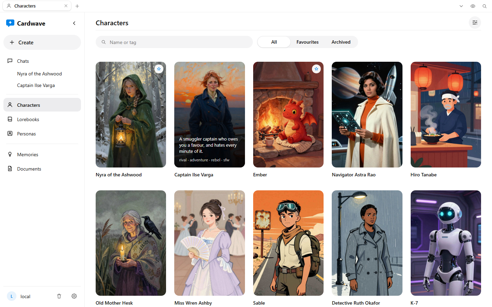
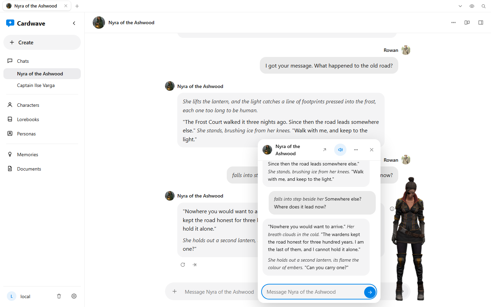
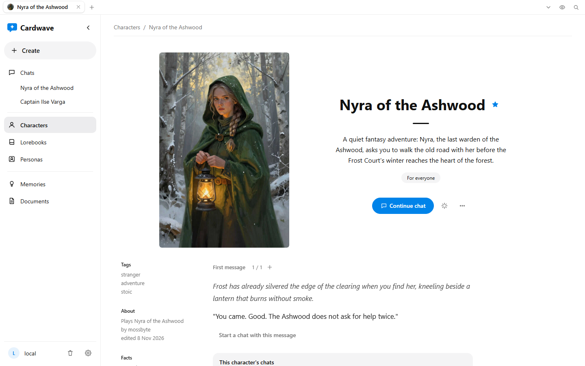
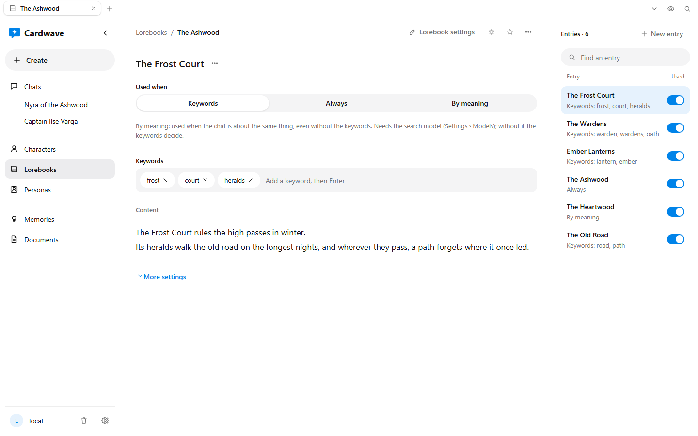

# Cardwave

Chat with characters. Bring any AI provider you already use, or run a model on your own computer. Your cards and chats stay with you.

**[Download for Windows](https://github.com/elana-voss/cardwave/releases/latest)** · [cardwave.cc](https://cardwave.cc)

Beta: Cardwave is in active development and this is its first public release. An update may not keep what an earlier version stored, so export the cards you care about and keep a backup.



## Features

- **Chat.** Talk with one character or several, who take turns or carry on among themselves. Go back to any message and try another path; personas say who you are, lorebooks what the world holds.
- **Cards.** Make a character from scratch or in a conversation with the AI, and edit it on its own page, where every text keeps its earlier drafts.
- **Library.** Find a character by name, tag or what it is about. The AI tags and summarises your cards, so each one says in a line what it offers.
- **Memory.** Characters remember what happened in your chats and can draw on documents you give them, for one chat or for every chat with that character.
- **Companion.** A 3D figure on your desktop that talks with you, reads its replies aloud and keeps you company, also as an everyday assistant.
- **Voices.** Replies read aloud in each character's own voice, on your computer. Dictate instead of typing.
- **Pictures.** Make an image inside a chat, or a new picture for a card.
- **Tools.** Let the model search the web, work in one folder or run commands, each only as you allow.
- **Coding team.** Give it a goal and a folder, and a team of AI agents works on it for you.
- **Local models.** Run models on your own computer, with no key and no account.
- **Tabs and themes.** Keep several chats and cards open in tabs. Light, dark or one of five more themes.
- **Locked and backed up.** A password locks the app; a backup is one file.
- **Your language.** Cardwave speaks twelve languages: English, German, Spanish, Portuguese (Brazil), Russian, Japanese, Korean, Chinese (simplified and traditional), Vietnamese, Indonesian and Hindi.



## Privacy

Cards, chats, keys and settings are stored on your computer, in an encrypted database. Cardwave talks to the provider you choose, downloads what you ask it to, and looks for a new version on GitHub (Settings turns that off). There is no Cardwave server in between, no sign-up and no analytics.



## Models

Paste an API key and Cardwave knows whose it is. More than 160 providers are known by name; any OpenAI-compatible server works by its address, one on your own computer included. Or point Cardwave at a folder of GGUF files and it runs them itself, on the graphics card where it can. There is no Cardwave subscription.



## Cards

Cardwave opens SillyTavern cards (PNG) and [CCV4](https://cardwave.cc/ccv4.html) cards, and exports either. A card's page is also its editor, and every text keeps its earlier drafts.



## Phones and other computers

Early: this works, but has not been thoroughly tested yet.

While Cardwave runs on your computer, phones and other computers in your home network can open it in a browser:

1. On the computer, open Account › Sharing and switch on "Reachable in the home network" under "Other devices".
2. Under "Accounts", press "Add account" and give each person a name and a password. Each account has chats and characters of its own.
3. On the other device, open the address Sharing shows beside "Address" (such as `http://192.168.1.20:8477/`), choose your account and type its password.

Only devices in the same network can reach it.

## Build from source

Cardwave is a Rust server with a TypeScript UI in a [Tauri 2](https://tauri.app) window. You need:

- Rust (stable), Node.js 24 and Python 3
- [Strawberry Perl](https://strawberryperl.com), first on `PATH` or named by `OPENSSL_SRC_PERL`: it builds SQLCipher's OpenSSL, which Git Bash's Perl cannot
- the [Vulkan SDK](https://vulkan.lunarg.com) (`VULKAN_SDK`) and libclang (`LIBCLANG_PATH`), for dictation's whisper.cpp

```sh
npm ci --prefix web && npm ci --prefix desktop
cd desktop
npm run dev     # the app, from source
npm run dist    # the installer, in target/release/bundle/nsis
```

Both fetch llama.cpp's `llama-server` into `desktop/llama` first (`tools/llama.py`); it runs local models and the search model.

Tests: `cargo test --workspace --exclude cardwave-desktop` for the server, `npm test` in `web/` for the UI's modules, `npm test` in `e2e/` for the browser tests (Playwright).

| Folder | What it holds |
| --- | --- |
| `crates/` | The server's libraries, one per job, depending only downward |
| `server/` | The HTTP API and the wiring of the libraries |
| `desktop/` | The Tauri shell, which runs the server inside the app |
| `web/` | The UI: Vite and TypeScript, no framework, in twelve languages |
| `e2e/` | The browser tests |
| `tools/` | Checks and the scripts that fetch or write shipped data |

Publishing a GitHub release builds the signed installer and the updater's feed (`.github/workflows/installer.yml`).

## License

Source-available under the [PolyForm Noncommercial License 1.0.0](LICENSE): free for personal use, study and other noncommercial purposes; commercial use needs written permission. The libraries and models that come with the app, and their licenses, are listed in the app under Settings › About Cardwave.

Bug reports and ideas are welcome in [Issues](https://github.com/elana-voss/cardwave/issues).

## The old Cardwave

This is the successor of the original Cardwave, the Flutter app for Windows, Android and the web, now at [elana-voss/cardwave-classic](https://github.com/elana-voss/cardwave-classic). The new Cardwave is rebuilt from the ground up in Rust and takes its place; the SillyTavern cards it made open here too.
